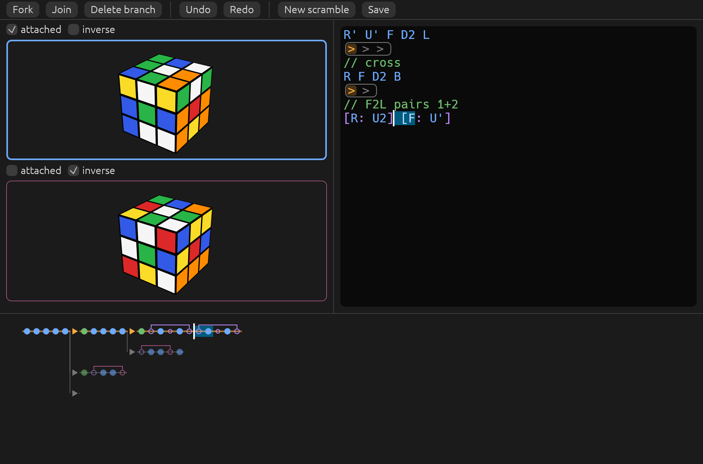

# multitime

A 3x3x3 simulator for trying out fewest-moves tools for Hyperspeedcube 2, mainly a forking timeline.



## use

```sh
cargo run [file]  # default: solve.txt
```

### forks

A `>` is like a line break that can have several next lines. The text box shows all of a fork's branches as a row of `>`s, with the current one highlighted. Click another to switch to it.

Press Cmd+Enter to fork at the caret. If there's text after it, that becomes the other branch.

In the text box, a `>` is plain text. Alone on its line, it splits the segment there: the text after it, and any branches, become a single branch. That's the same whether it's typed or pasted. Delete a `>` to merge its branch into what came before; any other branches then continue from the end of the merged text.

### text mode and twist mode

Esc cycles between text mode, twist mode on the first puzzle, and twist mode on the second. Clicking the text box or a puzzle also switches.

| Key | Text mode | Twist mode |
| --- | --- | --- |
| Most keys | insert text | insert a twist (see below) |
| Left, Right | move by character | move by token |
| Up, Down | move by line | switch branches |
| Backspace, Delete | delete a character | delete a token (a bracket deletes its whole group) |
| Home, End | go to the ends of the line | go to the ends of the path |

In twist mode, a `>` counts as a token. Hold Shift with Left, Right, Home, or End to select.

These work in both modes:

| Key | Action |
| --- | --- |
| Cmd+Z, Cmd+Shift+Z | undo, redo |
| Cmd+A, Cmd+C, Cmd+X, Cmd+V | select all, copy, cut, paste |
| Cmd+Enter | fork |
| Cmd+D | split the segment at the caret, without adding a branch |
| Cmd+J | merge this segment into its parent |
| Cmd+[, Cmd+] | switch branches |
| Cmd+S | save |

### mouse

| Where | Action | Result |
| --- | --- | --- |
| Puzzle | right-click, left-click a sticker | turn its face clockwise, counterclockwise |
| Puzzle | drag anywhere in the view | rotate the view like HSC |
| Timeline | click | move the caret |
| Timeline | double-click | move the caret, and end the text box's path at that segment |
| Timeline | drag, or Shift+click | select along a path |

### twist keys

| Keys | Moves, in the same order |
| --- | --- |
| `2 3 4 8 9 0` | `U2' M U' U M' M2'` |
| `Q W E R I O P` | `z' B L' y2' R B' z` |
| `A D F G H J K ;` | `y' L U' F' F U R' y` |
| `Z X C V B N M , . /` | `x' D L2' U2' D2 U2 R2' D' x x` |

### notation

| Notation | Meaning |
| --- | --- |
| `R U2 F'`, `Rw`, `r`, `2-3R` | face, wide, and layer turns |
| `M E S`, `x y z`, `@R` | slices and rotations |
| `(R U)3` | repeat |
| `[R, U]`, `[R: U]` | commutator, conjugate |
| `^(R U)` | moves on the inverse (NISS) |
| `.` | pause |
| `// text` | comment |

### files

A saved file is plain text. Each branch starts with a `>`, and its contents are indented:

```text
R' U' F D2 L
>
  // cross
  R F D2 B
>
  // cross, on the inverse
  ^(U F')
```

## dev

`cargo test` also renders the UI to `target/ui-*.png`.

## ref

- [hsc2](https://github.com/HactarCE/Hyperspeedcube)
- [notation](https://hypercubing.xyz/drafts/hyper-puzzle-notation/)
- [twizzle](https://alpha.twizzle.net/edit)
